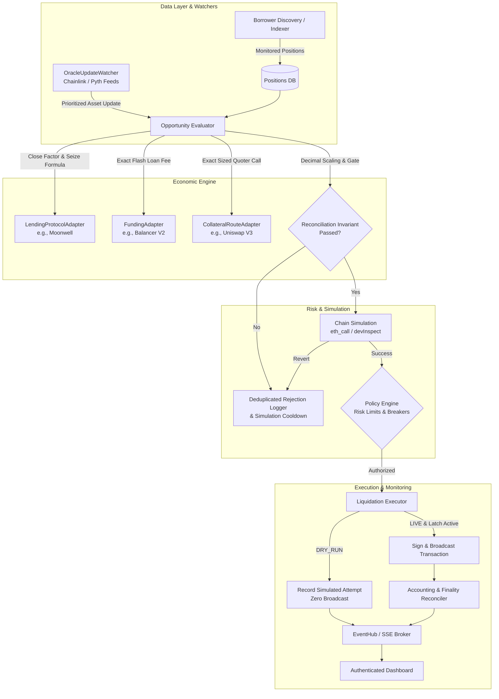

# Modular Liquidation Bot: System Architecture

**Document Version:** 1.0.0  
**Target Architecture:** Multi-Chain Liquidation Control Plane (EVM, Solana, Sui, Aptos)  

---

## 1. High-Level System Architecture

The Modular Liquidation Bot is structured around a strict pipeline that evaluates borrower positions, executes deterministic simulations, enforces mathematical reconciliation invariants, and manages operational risk.

---

## 2. Core Architectural Components

### 2.1 Domain Models & Interfaces (`core/`)
- **`ChainAdapter`**: Abstracts chain RPC reads, head block/slot tracking, native gas estimation, transaction simulation, and submission.
- **`LendingProtocolAdapter`**: Encapsulates protocol-specific math (close factors, liquidation bonuses, cToken exchange rates, collateral caps) and transaction call encoding.
- **`FundingAdapter`**: Abstracts flash loan and prefunded liquidity sources.
- **`CollateralRouteAdapter`**: Queries on-chain DEX quoters for exact sized trade proceeds rather than analytical spot estimations.

### 2.2 Token Decimal Normalization & Invariant Gate (`core/scaling.py`)
- Explicit decimal normalization ensures non-18 decimal tokens (e.g. USDC with 6 decimals, WBTC with 8 decimals, SOL/SUI with 9 decimals, APT with 8 decimals) scale without precision truncation.
- Native gas units (wei, lamports, MIST, octas) are converted into the debt asset's base units and reported in USD using fixed-point arithmetic with 6 decimal places ($0.000001 precision).
- Mandatory reconciliation invariant:
  $$\text{Collateral Proceeds}_{\text{debt units}} \ge \text{Repay}_{\text{debt units}} + \text{Flash Premium}_{\text{debt units}} + \text{Gas Fees}_{\text{debt units}} + \text{Min Profit}_{\text{debt units}}$$
  Any pricing or conversion failure causes immediate fail-closed rejection.

### 2.3 Event-Driven Oracle Watcher & Cooldown Guard (`discovery/`)
- **`OracleUpdateWatcher`**: Subscribes to oracle price events (Chainlink/Pyth). Upon detecting a price change for token $A$, immediately prioritizes re-evaluation of all borrower positions collateralized or borrowed in $A$.
- **Simulation Cooldown & State-Change Guard**:
  When a candidate fails simulation, the tuple `(protocol, account_id, debt_asset, collateral_asset)` enters a $\ge 60$s cooldown to prevent RPC exhaustion.
  If the oracle price or DEX pool reserves change, the state-change guard automatically invalidates the cooldown.
- **Deduplicated Rejection Logging**:
  Rejections deduplicate on `(protocol, account_id, reason_code)`. Volatile parameters (such as changing gas prices or exact wei amounts) are stored in the detail payload and excluded from the key.

### 2.4 Smart Contract Security Architecture (`contracts/evm/`)
The EVM executor contract (`FlashLiquidator.sol`) implements four strict on-chain invariants:
1. **Balance Snapshotting**: Records pre-existing debt token balance before receiving flash loans. Pre-existing balances cannot mask liquidation losses.
2. **Strict Callback Validation**: Callback reverts if `msg.sender` is not the immutable trusted flash loan vault or if not in an active loan session.
3. **Zero Allowance Cleanup**: Reset approvals to target lending protocol and DEX router to 0 immediately after execution.
4. **Atomic Profit Assertion**: Reverts atomically if net balance increase is below the configured minimum profit floor in the debt token.

### 2.5 Web Application Architecture (`web/`)
- **Frontend Choice:** Lightweight server-rendered UI (FastAPI + Jinja2 + Tailwind CSS) with Server-Sent Events (SSE) streaming at `/api/v1/stream`.
  - *Technical rationale:* Eliminates node build-step fragility and heavy frontend asset pipelines while delivering responsive, real-time desktop and tablet monitoring with sub-100ms updates.
- **Authentication:** Google OpenID Connect (OIDC) Authorization Code Flow with PKCE (`code_verifier` and S256 `code_challenge`), state, nonce, and explicit allowlist validation.
- **Session Security:** Opaque server-side sessions, HttpOnly secure cookies, CSRF protection, and recent reauthentication verification for sensitive actions (`CONFIRM_LIVE`).
